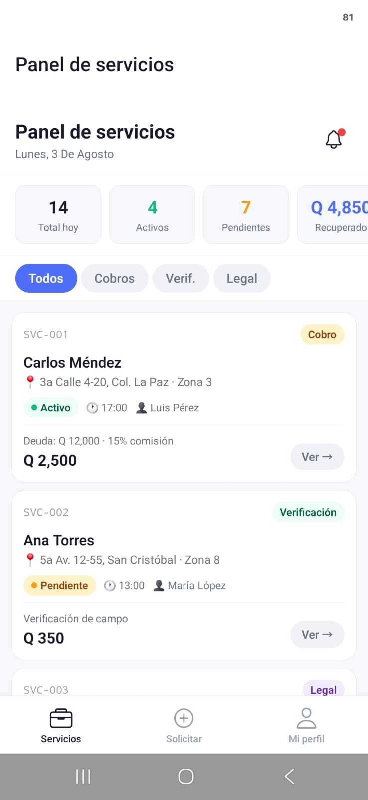
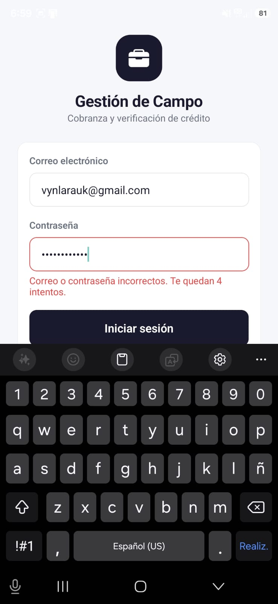
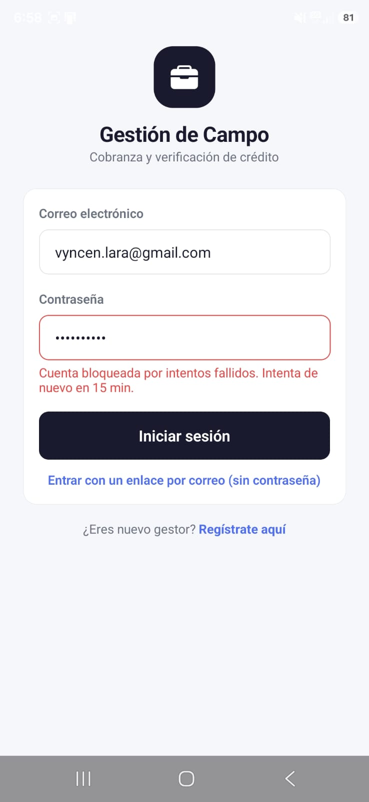
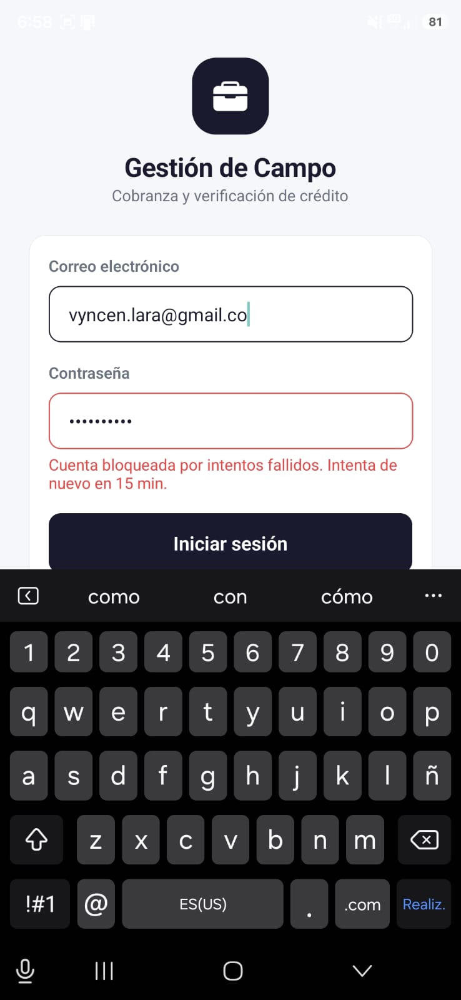
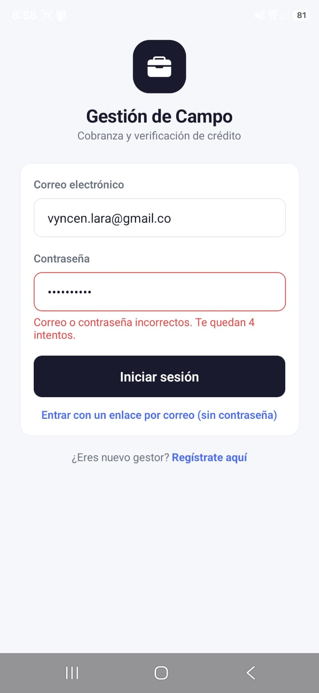
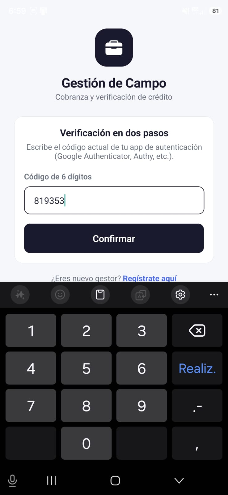

# Imágenes de referencia

## Home

---

## Biometría correcta

---

## Identificación correcta

### Identificación correcta 1

### Identificación correcta 2

---

## Identificación incorrecta

### Identificación incorrecta 1

### Identificación incorrecta 2

### Identificación incorrecta 3

---

## Intentos erróneos

---

## MFA correcto

